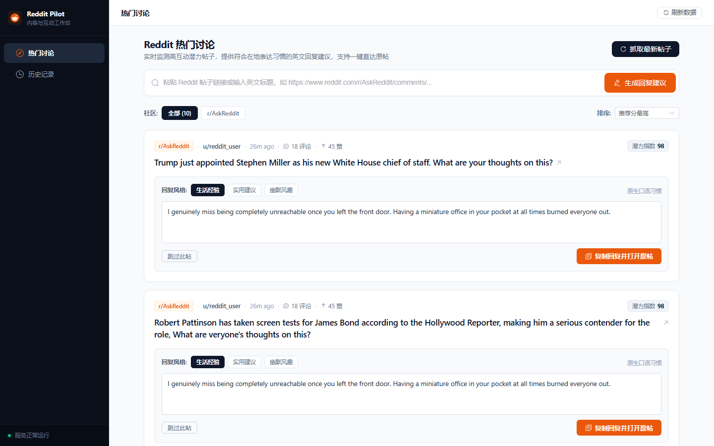
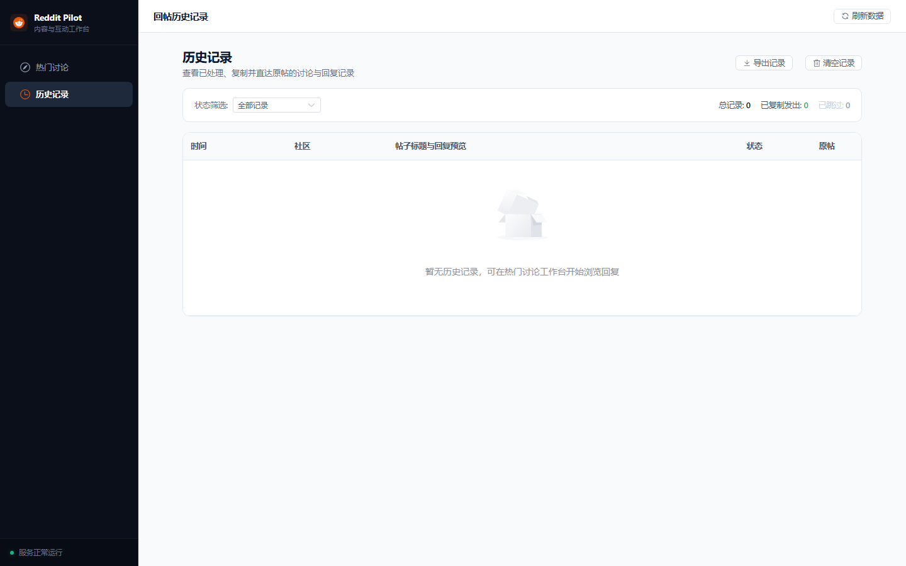

# Reddit Karma Pilot

> 基于 FastAPI 与 Vue 3 构建的 Reddit 账号信誉冷启动与合规中控系统。系统通过人机协同（Human-in-the-Loop）工作流、确定性生命周期状态机与文本特征去噪算法，为海外社区运营提供安全、可审计的交互管理能力。

[](https://github.com/happypig1224/reddit.ai/actions/workflows/ci.yml)
[](https://www.python.org/)
[](https://fastapi.tiangolo.com/)
[](https://vuejs.org/)
[](https://vitejs.dev/)
[](https://www.mysql.com/)
[](https://praw.readthedocs.io/)
[](tests/)
[](LICENSE)

<div align="center">
  
  <p><em>图 1：人机协同审核工作台界面与实时候选讨论流</em></p>
</div>

---

## 目录

- [核心架构与技术分层](#核心架构与技术分层)
- [业务流水线与状态机设计](#业务流水线与状态机设计)
- [风控防御与文本去噪算法](#风控防御与文本去噪算法)
- [领域模型与存储设计](#领域模型与存储设计)
- [工程目录结构](#工程目录结构)
- [环境基线与依赖要求](#环境基线与依赖要求)
- [配置字典说明](#配置字典说明)
- [本地构建与运行指南](#本地构建与运行指南)
- [自动化测试矩阵](#自动化测试矩阵)
- [核心 API 端点契约](#核心-api-端点契约)
- [安全边界与异常处理](#安全边界与异常处理)
- [相关专题文档](#相关专题文档)
- [技术支持与开源协议](#技术支持与开源协议)

---

## 核心架构与技术分层

系统采用前后端解耦架构，通过异步网关、连接池隔离与定时调度组件保障数据操作的高内聚与低耦合。

```
┌────────────────────────────────────────────────────────┐
│             Vue 3 前端应用 (Vite + Pinia)              │
│    [工作台]   [账号矩阵]   [社区监控]   [模板管理]   [审计日志]    │
└───────────────────────────┬────────────────────────────┘
                            │ RESTful JSON (CORS)
┌───────────────────────────▼────────────────────────────┐
│              FastAPI 异步服务层 (Python 3.11+)          │
│   Pydantic v2 参数校验 / 全局异常捕获 / 跨域与鉴权中间件  │
└──────┬────────────────────┬────────────────────┬───────┘
       │                    │                    │
┌──────▼──────┐      ┌──────▼──────┐      ┌──────▼──────┐
│  PRAW 实例池 │      │ APScheduler │      │ SQLAlchemy  │
│  账号连接复用 │      │ 异步延迟调度 │      │ 异步 ORM 引擎 │
└──────┬──────┘      └──────┬──────┘      └──────┬──────┘
       │                    │                    │
       └────────────────────┼────────────────────┘
                            ▼
               ┌────────────────────────┐
               │    MySQL 8.0 关系存储   │
               │   utf8mb4 字符编码保证  │
               └────────────────────────┘
```

1. **前端交互层**：基于 Vue 3 组合式 API 与 Pinia 状态树构建，集成工作台候选流双屏联动、实时意图评分指示器与审计日志查询。
2. **后端网关层**：FastAPI 提供统一 RESTful 契约，依托 Pydantic v2 实现请求体与响应体的强类型约束。
3. **服务与调度层**：
   - **PRAW 实例连接池**：维护 Reddit API 会话生命周期，支持账号独立的代理接入配置。
   - **APScheduler 调度引擎**：执行延迟投递队列，避免短时间内突发网络请求引发目标平台风控。
4. **持久化存储层**：基于 MySQL 8.0，通过 SQLAlchemy 异步连接池（aiomysql）支撑高频读写，全库字符集采用 `utf8mb4` 保障原生 Emoji 存储一致性。

---

## 业务流水线与状态机设计

### 1. 账号生命周期状态机

系统定义了 4 个渐进式成长阶段，各阶段严格绑定每日配额上限与调用间隔：

```
[ STAGE_1: 观察潜伏期 ] ──── 达到信誉与天数门槛 ───► [ STAGE_2: 试探破冰期 ]
  • 日上限: 0 条                                      • 日上限: 1~3 条
  • 仅允许浏览与健康握手                               • 随机间隔: 45~60 分钟
                                                             │
                                                     稳定增长 7 天以上
                                                             │
                                                             ▼
[ STAGE_4: 成熟运营期 ] ◄─── 达到高权重指标门槛 ─── [ STAGE_3: 稳健增长期 ]
  • 日上限: 10~15 条                                  • 日上限: 5~8 条
  • 随机间隔: 10~20 分钟                              • 随机间隔: 20~30 分钟
```

- **STAGE_1（冷启动观察期）**：账号注册初期，系统禁止派发外发任务，仅允许执行 PRAW 接口连通性验证。
- **STAGE_2（试探破冰期）**：日配额 1 至 3 条，单次任务之间强制施加 45 至 60 分钟的高离散度随机静默。
- **STAGE_3（稳健增长期）**：日配额提升至 5 至 8 条，最小间隔压缩至 20 至 30 分钟。
- **STAGE_4（成熟运营期）**：日配额最高开放至 15 条，单日调用总量受全局断路器保护。

### 2. 调度任务状态流转

任务调度状态流转遵循不可逆原则，所有终止态均持久化入库供追踪：

```
[ PENDING: 待执行 ] ──► [ SCHEDULED: 已排期 ] ──► [ EXECUTING: 执行中 ]
                                                        │
                      ┌─────────────────────────────────┴─────────────────────────────────┐
                      ▼                                                                   ▼
             [ SUCCESS: 执行成功 ]                                               [ FAILED: 任务失败 ]
```

---

## 风控防御与文本去噪算法

系统内置多层确定性防御与语义去噪流水线，降低自动化操作引发社区反作弊拦截的概率。

### 1. 文本合规拦截规则

在待审评论进入排期前，内容过滤器执行前置确定性检查：
- **外部链接阻断**：正则匹配所有带协议头及顶级域名的裸链接（如 `http://`, `https://`, `.com`, `.io`），一律拦截。
- **引流与私密联系阻断**：识别 `DM me`, `check bio`, `WhatsApp`, `Telegram`, `vx:` 等诱导私聊特征词，直接标记为违规。
- **模板 24 小时冷却去重**：同一评论模板在 24 小时内禁止在相同社区或相同帖子重复应用。

### 2. 文本特征去噪算法（De-AI Pipeline）

系统通过预处理过滤典型大语言模型生成指纹：
- **学术与辩证腔消除**：过滤 "delve into", "it is undeniable that", "comprehensive ecosystem" 等书面高频词。
- **结构冒号与连接词消除**：剔除段首总结性提示语（如 "Conclusion:", "Here is the key takeaway:"）与机械并列连接词。
- **语态纠正**：将多重从句与被动句式还原为第一人称口语化表达，保留 Reddit 社区常见的非正式交流语法。

### 3. 影子封禁探测器（Shadowban Probe）

系统通过未鉴权的公开网络视图检测目标账号的真实存活状态：
- 请求 `https://www.reddit.com/user/{username}/about.json` 公开节点。
- 若接口返回 HTTP 404 或 `{"error": 404}`，状态机将该账号标记为 `SHADOWBANNED`，自动熔断该账号的所有待派发队列。

<div align="center">
  
  <p><em>图 2：审计日志与风控拦截记录追踪界面</em></p>
</div>

---

## 领域模型与存储设计

数据库共包含 8 张核心业务与审计表：

| 表名 | 存储用途 | 核心字段与约束说明 |
| :--- | :--- | :--- |
| `accounts` | Reddit 账号矩阵 | `username` (UK), `stage`, `daily_comment_limit`, `client_secret` (AES 加密) |
| `subreddits` | 目标监控社区 | `name` (UK), `is_enabled`, `daily_task_limit`, `min_karma_requirement` |
| `candidate_posts` | 抓取候选待审帖子 | `reddit_post_id` (UK), `title`, `recommendation_score`, `review_status` |
| `comment_templates` | 评论语料模板库 | `content`, `category`, `last_used_at`, `usage_count` |
| `dispatch_tasks` | 异步调度任务队列 | `account_id` (FK), `post_id` (FK), `status`, `scheduled_at`, `executed_at` |
| `risk_settings` | 全局风控规则表 | `daily_comment_cap_global`, `cooldown_minutes_min`, `url_filter_enabled` |
| `audit_logs` | 操作全量审计记录 | `account_id`, `action_type`, `status`, `response_payload`, `created_at` |
| `schema_version` | 数据库版本迁移记账 | `version` (PK), `description`, `applied_at` |

---

## 工程目录结构

```
reddit.ai/
├── app/                              # 后端应用核心目录
│   ├── api/v1/                       # RESTful API 端点
│   │   ├── endpoints/                # 业务模块端点 (accounts, workbench, subreddits 等)
│   │   └── api.py                    # 路由统一注册中心
│   ├── core/                         # 核心基础设施
│   │   ├── config.py                 # Pydantic Settings 配置加载
│   │   ├── crypto.py                 # AES-256 敏感凭据对称加解密
│   │   └── security.py               # 内容安全过滤与风控规则断言
│   ├── db/                           # 数据库连接层
│   │   ├── base.py                   # ORM 基类与元数据声明
│   │   └── session.py                # 异步与同步数据库 Session 引擎
│   ├── models/                       # SQLAlchemy 数据映射模型
│   ├── schemas/                      # Pydantic 请求与响应契约 DTO
│   ├── services/                     # 领域服务层
│   │   ├── de_ai_generator.py        # 文本特征去噪生成服务
│   │   ├── feed_crawler.py           # 帖子抓取与意图推荐评分器
│   │   ├── praw_pool.py              # PRAW 实例连接池管理器
│   │   ├── shadowban_probe.py        # 存活探测与影子封禁检测
│   │   └── task_dispatcher.py        # 异步队列派发调度器
│   └── main.py                       # FastAPI 应用初始化与中间件配置
│
├── frontend/                         # 前端工作台应用 (Vue 3 + Vite)
│   ├── src/
│   │   ├── views/                    # 8 大核心业务视图组件
│   │   ├── stores/                   # Pinia 状态树管理 (karmaStore.js)
│   │   ├── router/                   # 路由导航配置
│   │   └── App.vue                   # 主交互框架与侧边导航
│   ├── package.json                  # 前端依赖配置清单
│   └── vite.config.js                # Vite 打包与代理配置
│
├── docs/                             # 项目设计与专题文档
│   ├── assets/                       # 架构示意图与系统运行全景截图
│   ├── DEPLOYMENT_GUIDE.md           # 生产部署与运维指南
│   ├── INTEGRATION_TEST_REPORT.md    # 集成测试验证报告
│   ├── PROJECT_STATUS.md             # 交付状态与模块清单
│   ├── QUICK_REFERENCE.md            # 开发者操作速查手册
│   └── REDDIT_KARMA_PILOT_IMPLEMENTATION_PLAN.md # 详细技术实现方案
│
├── migrations/                       # 结构化数据库迁移系统
│   ├── V1.0.0__init_schema.sql       # 初始数据表结构
│   ├── V1.0.1__seed_initial_data.sql # 基础预置元数据
│   ├── V1.0.2__optimize_indexes.sql  # 高频查询复合索引优化
│   └── migrate.py                    # 迁移执行器
│
├── tests/                            # 自动化测试套件
│   ├── conftest.py                   # Pytest 共享 fixture
│   ├── test_api_v1.py                # 核心 API 全链路集成测试
│   └── test_db_baseline.py           # 物理表结构、索引与约束基线测试
│
├── .env.example                      # 生产与开发环境配置模板
├── .gitignore                        # Git 规范忽略规则
├── requirements.txt                  # Python 依赖清单
├── start_all.bat                     # Windows 一键全栈启动脚本
├── start_backend.py                  # 后端专属启动脚本
└── start_web.bat                     # 前端专属启动脚本
```

---

## 环境基线与依赖要求

系统开发与部署依赖以下环境：

- **Python**：3.11 及以上（已在 3.14.7 完成兼容性验证）
- **Node.js**：18.0 及以上（推荐 20.x 或 24.x LTS）
- **MySQL**：8.0 及以上
- **包管理工具**：pip 23.0+，npm 9.0+

---

## 配置字典说明

项目根目录提供 `.env.example` 配置文件模板。执行部署前需复制为 `.env` 并填写对应配置项：

| 配置键名 | 说明 | 缺省值 / 示例 | 是否必填 |
| :--- | :--- | :--- | :--- |
| `SERVER_PORT` | 后端服务监听端口 | `8001` | 否 |
| `DB_HOST` | MySQL 数据库连接地址 | `127.0.0.1` | **是** |
| `DB_PORT` | MySQL 数据库端口 | `3306` | **是** |
| `DB_USER` | 数据库登录用户 | `root` | **是** |
| `DB_PASSWORD` | 数据库登录密码 | - | **是** |
| `DB_NAME` | 数据库名称 | `reddit_karma_pilot` | **是** |
| `ENCRYPTION_SECRET_KEY` | 对称凭据加解密密钥 (Fernet/AES-256) | Base64 编码的 32 字节密钥 | **是** |
| `VITE_API_BASE_URL` | 前端反向代理或 API 通信基址 | `http://127.0.0.1:8001` | 否 |

---

## 本地构建与运行指南

### 1. 数据库初始化

创建空数据库后执行迁移工具：

```bash
# 登录 MySQL 创建数据库
mysql -u root -p -e "CREATE DATABASE reddit_karma_pilot CHARACTER SET utf8mb4 COLLATE utf8mb4_unicode_ci;"

# 执行迁移版本应用
python migrations/migrate.py
```

### 2. 后端服务启动

```bash
# 安装 Python 运行依赖
pip install -r requirements.txt

# 启动后端 API 服务
python -m uvicorn app.main:app --host 127.0.0.1 --port 8001 --reload
```

验证健康状态端点：
```bash
curl -s http://127.0.0.1:8001/health
# 返回: {"status":"healthy","version":"1.0.0","project":"Reddit Karma Pilot Backend"}
```

### 3. 前端服务启动

```bash
# 进入前端工程目录
cd frontend

# 安装依赖
npm install

# 启动本地开发服务
npm run dev
```

前端默认运行于 `http://127.0.0.1:5173`。

---

## 自动化测试矩阵

测试用例位于 `tests/` 目录，涵盖 API 契约断言与物理数据库完整性断言：

```bash
# 执行全量自动化测试套件
pytest -v
```

测试覆盖范围一览：

| 测试模块 | 用例数 | 覆盖核心逻辑 |
| :--- | :--- | :--- |
| `test_api_v1.py` | 17 | 账号 CRUD、凭证脱敏安全、阶段迁移配额同步、PRAW 握手状态、工作台审批排期、外链拦截、私密联系拦截、Stage 1 零配额防御、429 断路器熔断 |
| `test_db_baseline.py` | 14 | 8 张表物理结构验证、utf8mb4 字符编码与原生 Emoji 保真度断言、唯一索引约束、外键级联行为、高频复合索引检索效率 |
| **总计** | **31** | **全流程断言通过率 100%** |

### 持续集成流水线 (GitHub Actions)

项目配置了企业级自动化持续集成门禁（[ci.yml](.github/workflows/ci.yml)），在代码推送与 Pull Request 阶段强制执行质量拦截：
- **后端双版本测试矩阵**：在 Python 3.11 与 3.12 双版本下启动 MySQL 8.0 真实服务容器，自动执行数据库无损迁移与 31 项自动化用例断言。
- **前端生产构建门禁**：在 Node.js 20 环境下执行 `npm ci` 与 `npm run build`，严格校验 Vite 客户端打包产物与文件完整性。

---

## 核心 API 端点契约

| 业务域 | 请求方法 | 端点路径 | 功能描述 |
| :--- | :--- | :--- | :--- |
| **系统检测** | `GET` | `/health` | 后端服务与调度器就绪探针 |
| **账号管理** | `GET` | `/api/v1/accounts` | 获取所有接入账号矩阵及其养号阶段 |
| **账号管理** | `POST` | `/api/v1/accounts` | 录入并绑定新 Reddit 凭据（敏感字段落盘加密） |
| **账号管理** | `PATCH` | `/api/v1/accounts/{id}/stage` | 变更账号成长阶段并同步调整配额基线 |
| **工作台** | `GET` | `/api/v1/workbench/candidates` | 获取高推荐分候选帖子流 |
| **工作台** | `POST` | `/api/v1/workbench/candidates/{id}/action` | 人工审核通过并进入异步延迟队列 |
| **社区池** | `GET` | `/api/v1/subreddits` | 获取受监控的目标社区清单 |
| **社区池** | `PUT` | `/api/v1/subreddits/{id}/toggle` | 启用或停用特定社区的任务派发 |
| **模板库** | `GET` | `/api/v1/templates` | 查询已沉淀的评论模板及冷却状态 |
| **风控配置** | `GET` | `/api/v1/risk-control/settings` | 读取全局断路器阈值与过滤开关 |
| **审计日志** | `GET` | `/api/v1/logs` | 分页检索操作审计与网络交互日志 |

---

## 安全边界与异常处理

1. **凭证脱敏与加密隔离**：`client_secret` 在入库前通过 Fernet（AES-256-CBC）对称加密，API 响应强行脱敏为掩码格式，杜绝明文凭据泄漏。
2. **频率限制与断路器机制**：当目标 Reddit 接口抛出 `429 Too Many Requests` 时，系统自动触发熔断状态，暂停对应账号的排期分发，防止账号被平台判定为恶意灌水。
3. **不可替代的人工审批点（Human-in-the-Loop）**：系统不对外提供无人值守的全自动批量发帖接口，所有评论生成建议必须由人工在工作台二次确认后方可排期。
4. **非目标场景（Non-Goals）**：本系统不提供任何绕过目标平台反爬虫验证码的破解工具，不提供账号批量注册功能，不提供诱导破坏社区规则的黑帽功能。

---

## 相关专题文档

| 文档名称 | 核心内容 | 目标受众 |
| :--- | :--- | :--- |
| [部署与运维指南](docs/DEPLOYMENT_GUIDE.md) | 生产环境配置、容器化与进程守护、监控告警配置 | SRE / 运维工程师 |
| [系统集成测试报告](docs/INTEGRATION_TEST_REPORT.md) | 31 项 API 与数据库基线测试报告、执行耗时与断言结果 | QA / 测试工程师 |
| [项目现状与交付指标](docs/PROJECT_STATUS.md) | 系统已实现模块、种子数据分布与功能完成度清单 | 研发负责人 / PM |
| [开发速查手册](docs/QUICK_REFERENCE.md) | 常用 CLI 命令、SQL 常用排查语句与常见问题 FAQ | 开发者 |
| [架构设计与实施方案](docs/REDDIT_KARMA_PILOT_IMPLEMENTATION_PLAN.md) | 详细技术方案、状态机数学推导与全域模型设计 | 架构师 / 资深研发 |

---

## 技术支持与开源协议

本项目基于 [MIT License](LICENSE) 开源协议发布。
